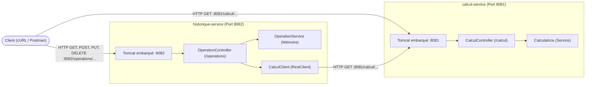

# TP3 REST : Microservices « Calculatrice » avec Spring Boot

**Faculté des Sciences de Sfax**  
**Département d'informatique et des Communications**  
*Année Universitaire : 2026-2027*  
*Matière :* Architecture MicroServices  
*Filière :* MPSRCC1  
*Enseignantes :* Corinne Amel ZAYANI, Amal ABID  

---

## 📋 Table des Matières
1. [Présentation et Objectifs](#-présentation-et-objectifs)
2. [Architecture et Découpage des Microservices](#-architecture-et-découpage-des-microservices)
3. [Structure Globale du Projet](#-structure-globale-du-projet)
4. [Partie A : Du Service Web au Microservice (Questions A.4)](#-partie-a--du-service-web-au-microservice)
5. [Partie B : Configuration des Projets Maven](#-partie-b--configuration-des-projets-maven)
6. [Partie C : Premier Microservice - calcul-service (La Somme)](#-partie-c--premier-microservice--calcul-service)
7. [Partie D : Compléter la Calculatrice (Questions D.1, D.2, D.3)](#-partie-d--compléter-la-calculatrice)
8. [Partie E : Échanger des Données en JSON (Questions E.1, E.2)](#-partie-e--échanger-des-données-en-json)
9. [Partie F : Second Microservice - historique-service](#-partie-f--second-microservice--historique-service)
10. [Partie F.7 : Expérience d'Arrêt d'un Microservice (Questions F.1, F.2)](#-partie-f7--expérience-darrêt-dun-microservice)
11. [Parties F.8 et F.9 : Modification (PUT) et Suppression (DELETE)](#-parties-f8-et-f9--modification-put-et-suppression-delete)
12. [Questions de Synthèse](#-questions-de-synthèse)
13. [Instructions d'Exécution et Captures](#-instructions-dexécution-et-captures)

---

## 🎯 Présentation et Objectifs

Dans le **TP2**, une seule application monolithique (`RestWebApp.war`) développée avec **JAX-RS** (Jersey) regroupait toute la logique métier et était déployée dans un serveur Tomcat externe.

Dans ce **TP3**, la même calculatrice est réarchitecturée sous la forme de **deux microservices indépendants et autonomes** développés avec **Spring Boot** :
1. **`calcul-service`** (Port `8081`) : effectue les calculs arithmétiques purs (somme, soustraction, produit, division) et expose l'API `/calcul`.
2. **`historique-service`** (Port `8082`) : assure la gestion et la persistance en mémoire de l'historique des opérations via l'API `/operations`. Pour obtenir le résultat d'un calcul, il délègue la tâche à `calcul-service` par requête HTTP via le client moderne **`RestClient`** de Spring.

### Technologies Utilisées
- **Java SE 17+** (OpenJDK 25 LTS / OpenJDK 21 LTS)
- **Spring Boot 4.0.9** (`spring-boot-starter-webmvc`, Jackson, Tomcat 11 embarqué)
- **Spring Framework RestClient** pour la communication inter-microservices
- **Maven 3.9+**
- Outils de test : **cURL**, **Postman**

---

## 🏗️ Architecture et Découpage des Microservices



### Table des Endpoints et Rôles

| Microservice | Port | Verbe | URI | Rôle |
| :--- | :--- | :--- | :--- | :--- |
| `calcul-service` | `8081` | `GET` | `/calcul/somme?a=2&b=3` | Retourne $a + b$ |
| `calcul-service` | `8081` | `GET` | `/calcul/soustraction?a=2&b=3` | Retourne $a - b$ |
| `calcul-service` | `8081` | `GET` | `/calcul/produit?a=2&b=3` | Retourne $a \times b$ |
| `calcul-service` | `8081` | `GET` | `/calcul/division?a=6&b=3` | Retourne $a \div b$ |
| `calcul-service` | `8081` | `GET` | `/calcul/produit/{a}/{b}` | Produit via variables de chemin (`@PathVariable`) |
| `calcul-service` | `8081` | `GET` | `/calcul/somme/detail?a=2&b=3` | Retourne un objet `Resultat` en JSON |
| `calcul-service` | `8081` | `GET` | `/calcul/division/detail?a=7&b=2` | Retourne un objet `Resultat` en JSON (ou 400 si $b=0$) |
| `historique-service` | `8082` | `POST` | `/operations` | Crée une opération (calcul délégué à `calcul-service`) |
| `historique-service` | `8082` | `GET` | `/operations` | Retourne toutes les opérations enregistrées |
| `historique-service` | `8082` | `GET` | `/operations/{id}` | Retourne l'opération numéro `id` |
| `historique-service` | `8082` | `PUT` | `/operations/{id}` | Modifie l'opération numéro `id` |
| `historique-service` | `8082` | `DELETE` | `/operations/{id}` | Supprime l'opération numéro `id` |

---

## 📁 Structure Globale du Projet

```text
tp3-ms/
├── README.md
├── .gitignore
├── operation.json
├── modification.json
├── capture/                                      # Logs et captures des tests d'exécution
│   ├── console_startup.txt
│   ├── calcul_service_console.log
│   ├── historique_service_console.log
│   └── *.txt (sorties curl)
├── question/
│   └── reponse                                   # Réponses textuelles
├── calcul-service/
│   ├── pom.xml
│   └── src/main/
│       ├── java/com/exemple/calcul/
│       │   ├── CalculServiceApplication.java     # Point d'entrée (@SpringBootApplication)
│       │   ├── controller/
│       │   │   └── CalculController.java         # Contrôleur REST (/calcul)
│       │   ├── service/
│       │   │   └── Calculatrice.java             # Logique métier pure (@Service)
│       │   └── model/
│       │       └── Resultat.java                 # Modèle DTO JSON
│       └── resources/
│           └── application.properties            # Configuration (port 8081)
└── historique-service/
    ├── pom.xml
    └── src/main/
        ├── java/com/exemple/historique/
        │   ├── HistoriqueServiceApplication.java # Point d'entrée (@SpringBootApplication)
        │   ├── controller/
        │   │   └── OperationController.java      # Contrôleur REST CRUD (/operations)
        │   ├── service/
        │   │   └── OperationService.java         # Gestion mémoire (ConcurrentHashMap)
        │   ├── client/
        │   │   └── CalculClient.java             # Client HTTP distant (RestClient)
        │   └── model/
        │       └── Operation.java                # Entité métier Operation
        └── resources/
            └── application.properties            # Configuration (port 8082 + calcul.service.url)
```

---

## 📝 Partie A : Du Service Web au Microservice

### A.3 Tableau Comparatif : Service Web (TP2) vs Microservices (TP3)

| Aspect | Service web du TP2 | Microservice du TP3 |
| :--- | :--- | :--- |
| **Technologie** | JAX-RS (implémentation Jersey) | Spring Boot (Spring MVC) |
| **Découpage** | Une seule application : calcul et historique dans le même `.war` | Deux applications indépendantes : `calcul-service` et `historique-service` |
| **Résultat de la construction** | Fichier `.war` (archive web) | Fichier `.jar` exécutable (application + serveur Tomcat embarqué) |
| **Serveur** | Tomcat installé séparément (dépôt du `.war`) | Tomcat embarqué dans le `.jar` (`java -jar`) |
| **Port** | `8080`, unique et partagé par toutes les applications | Un port distinct par microservice (`8081`, `8082`) fixé dans `application.properties` |
| **Adresse** | `http://localhost:8080/RestWebApp/api/calcul/somme` | `http://localhost:8081/calcul/somme` |
| **Activation** | Classe `RestApplication` avec `@ApplicationPath` | Classe `...Application` avec `@SpringBootApplication` et méthode `main` |
| **Ressource REST** | Classe annotée `@Path` | Classe annotée `@RestController` et `@RequestMapping` |
| **Verbes HTTP** | `@GET`, `@POST`, `@PUT`, `@DELETE` | `@GetMapping`, `@PostMapping`, `@PutMapping`, `@DeleteMapping` |
| **Paramètres** | `@QueryParam`, `@PathParam`, `@Consumes` | `@RequestParam`, `@PathVariable`, corps avec `@RequestBody` |
| **Réponse HTTP** | `Response` / `Response.ok(...).build()` | `ResponseEntity` / `ResponseEntity.ok(...)` |
| **Conversion JSON** | JSON-B (`jersey-media-json-binding`) | Jackson (inclus de base dans Spring Boot) |
| **Création des objets** | `new Calculatrice()`, attributs `static` pour partager l'état | Objets gérés par le conteneur Spring (`@Service`, injection par constructeur) |
| **Communication** | Appel direct en mémoire Java entre classes du même JVM | Requête HTTP réseau via `RestClient` |

---

### A.4 Questions de Conception

#### 1. Dans le TP2, le résultat d'une opération était calculé par un simple appel de méthode. Dans ce TP, il est obtenu par une requête HTTP vers un autre microservice. Citez un avantage et un inconvénient de ce choix.
> **Réponse :**  
> - **Avantage :** Découplage complet des responsabilités et indépendance de déploiement et de montée en charge (*scalabilité*). Si les calculs nécessitent de lourdes ressources CPU, on peut répliquer `calcul-service` indépendamment de `historique-service`.  
> - **Inconvénient :** Introduction d'une surcharge réseau (*overhead* de sérialisation JSON et latence HTTP) et gestion obligatoire des pannes réseau ou d'indisponibilité partielle (*fallbacks*, timeouts).

#### 2. Si calcul-service est arrêté, quelles requêtes du tableau A.2 continuent de fonctionner ? Lesquelles échouent ?
> **Réponse :**  
> - **Continuent de fonctionner :** Les requêtes de consultation de l'historique qui lisent uniquement l'état stocké dans `historique-service` : `GET /operations`, `GET /operations/{id}`, ainsi que la suppression `DELETE /operations/{id}`.  
> - **Échouent :** Toutes les requêtes nécessitant un calcul : l'ensemble des routes `GET /calcul/...` (le service est éteint), ainsi que `POST /operations` et `PUT /operations/{id}` car ils doivent interroger `calcul-service` pour obtenir le résultat.

#### 3. Pourquoi les deux microservices ne peuvent-ils pas écouter sur le même port ?
> **Réponse :**  
> Au niveau du protocole TCP/IP géré par le système d'exploitation, un seul processus serveur peut s'attacher (*bind*) à un numéro de port spécifique sur une interface réseau donnée. Lancer un second service sur le même port déclenche immédiatement une erreur d'adresse déjà utilisée (`BindException: Address already in use`).

#### 4. Quel code de statut HTTP historique-service doit-il renvoyer quand il ne parvient pas à joindre calcul-service ?
> **Réponse :**  
> Il doit renvoyer le code **`503 Service Unavailable`** (ou `502 Bad Gateway`). Ce code indique au client que le serveur actuel agit en tant que coordinateur et ne peut temporairement pas contacter le service distant nécessaire pour finaliser le traitement, sans qu'il ne s'agisse d'une erreur de la requête du client (4xx) ni d'un crash interne de `historique-service`.

---

## ⚙️ Partie B : Configuration des Projets Maven

Chaque microservice est configuré dans son propre `pom.xml` autonome hérité de `spring-boot-starter-parent` (version `4.0.9`) avec la dépendance `spring-boot-starter-webmvc` :

```xml
<parent>
    <groupId>org.springframework.boot</groupId>
    <artifactId>spring-boot-starter-parent</artifactId>
    <version>4.0.9</version>
    <relativePath/>
</parent>

<dependencies>
    <dependency>
        <groupId>org.springframework.boot</groupId>
        <artifactId>spring-boot-starter-webmvc</artifactId>
    </dependency>
</dependencies>
```

Le plugin `spring-boot-maven-plugin` permet de construire un **gros JAR exécutable (*fat-jar*)** contenant tout le bytecode compilé, les bibliothèques et le serveur Tomcat 11 embarqué.

---

## 🧮 Partie C : Premier Microservice : `calcul-service`

### C.2 & C.4 Configuration et Contrôleur
Dans `calcul-service/src/main/resources/application.properties` :
```properties
spring.application.name=calcul-service
server.port=8081
```

Dans `CalculController.java`, la méthode de somme :
```java
@GetMapping(value = "/somme", produces = MediaType.TEXT_PLAIN_VALUE)
public ResponseEntity<String> somme(@RequestParam("a") int a,
                                    @RequestParam("b") int b) {
    int result = calculService.somme(a, b);
    return ResponseEntity.ok(String.valueOf(result));
}
```

### Correspondance avec le TP2 (Tableau page 9)
| Spring (TP3) | JAX-RS (TP2) | Rôle dans cet exemple |
| :--- | :--- | :--- |
| `@RestController` | *(pas d'équivalent direct)* | Déclare le contrôleur REST Spring ; sérialise automatiquement le retour dans la réponse HTTP. |
| `@RequestMapping("/calcul")` | `@Path("/calcul")` sur la classe | Définit le préfixe d'URI de base pour toutes les routes du contrôleur. |
| `@GetMapping("/somme")` | `@GET` + `@Path("/somme")` | Associe la méthode à la requête HTTP `GET /calcul/somme`. |
| `produces = MediaType.TEXT_PLAIN_VALUE` | `@Produces(MediaType.TEXT_PLAIN)` | Indique que le format renvoyé est du texte brut (`text/plain;charset=UTF-8`). |
| `@RequestParam("a") int a` | `@QueryParam("a") int a` | Extrait le paramètre nommé `a` de la query string et le convertit en entier. |
| `ResponseEntity.ok(...)` | `Response.ok(...).build()` | Construit la réponse HTTP avec statut `200 OK` et le corps fourni. |

### C.6 & C.7 Analyse de l'URL et Tests

#### Question C.1. Comparez cette URL avec celle du TP2 (`http://localhost:8080/RestWebApp/api/calcul/somme?a=2&b=3`). Quelles parties ont disparu, et pourquoi ?
> **Réponse :**  
> Le contexte d'application `/RestWebApp` et le préfixe d'API `/api` ont disparu. Spring Boot écoute directement à la racine (`/`) de son propre Tomcat embarqué sur le port dédié `8081`. Il n'y a plus besoin de distinguer plusieurs applications au sein d'un même serveur de conteneurs.

#### Question C.2. Remplacez GET par POST dans Postman et renvoyez la requête. Quel code de statut obtenez-vous ? Est-ce le même qu'au TP2 ?
> **Réponse :**  
> On obtient le statut **`405 Method Not Allowed`**. C'est exactement le même code de statut qu'au TP2, car la route est configurée pour n'accepter que le verbe `GET`.

Sortie curl correspondante :
```http
HTTP/1.1 200 
Content-Type: text/plain;charset=UTF-8
Content-Length: 1

5
```

---

## ➕ Partie D : Compléter la Calculatrice

### D.1 Soustraction et Produit
Ajout des méthodes `soustraction` et `produit` dans `CalculController` :
- `GET /calcul/soustraction?a=10&b=4` $\rightarrow$ Réponse : `6` (Statut 200)
- `GET /calcul/produit?a=6&b=7` $\rightarrow$ Réponse : `42` (Statut 200)

### D.2 Division et Gestion d'Erreur
```java
@GetMapping(value = "/division", produces = MediaType.TEXT_PLAIN_VALUE)
public ResponseEntity<String> division(@RequestParam("a") int a,
                                       @RequestParam("b") int b) {
    if (b == 0) {
        return ResponseEntity.badRequest()
                .body("Erreur : division par 0 impossible");
    }
    double result = calculService.division(a, b);
    return ResponseEntity.ok(String.valueOf(result));
}
```
- `GET /calcul/division?a=7&b=2` $\rightarrow$ Statut `200 OK`, corps `3.5`
- `GET /calcul/division?a=7&b=0` $\rightarrow$ Statut `400 Bad Request`, corps `Erreur : division par 0 impossible`

### D.3 Observations

#### Question D.1. Au TP2, JAX-RS donnait la valeur 0 à un paramètre entier absent et la méthode somme s'exécutait. Que fait Spring dans le même cas ? Laquelle des deux attitudes vous paraît la plus conforme à REST ?
> **Réponse :**  
> Spring Boot rejette la requête immédiatement avec le statut **`400 Bad Request`**, car par défaut tous les `@RequestParam` sont obligatoires (`required=true`). L'attitude de Spring est nettement plus conforme à REST et aux standards de robustesse : une requête incomplète côté client doit être signalée en erreur explicite plutôt que de conduire silencieusement à un calcul erroné avec une valeur par défaut arbitraire (0).

#### Question D.2. Avec curl ou Postman, Spring renvoie ses messages d'erreur sous forme d'objet JSON. Quels champs contient-il ?
> **Réponse :**  
> L'objet JSON généré par Spring Boot contient :
> - `timestamp` : Date et heure de l'anomalie.
> - `status` : Code d'erreur numérique HTTP (`400`).
> - `error` : Libellé standard du statut (`"Bad Request"`).
> - `path` : URI ciblée par la requête fautive (`"/calcul/somme"`).

### D.4 Paramètres dans le chemin : `@PathVariable`
```java
@GetMapping(value = "/produit/{a}/{b}", produces = MediaType.TEXT_PLAIN_VALUE)
public ResponseEntity<String> produitChemin(@PathVariable("a") int a,
                                            @PathVariable("b") int b) {
    return ResponseEntity.ok(String.valueOf(calculService.produit(a, b)));
}
```
Test : `GET /calcul/produit/6/7` $\rightarrow$ retourne `42`.

#### Question D.3. Complétez le tableau de correspondance : à quelles annotations JAX-RS correspondent `@RequestParam` et `@PathVariable` ? Laquelle utilisera-t-on pour lire l'identifiant dans `/operations/{id}` ?
> **Réponse :**  
> - `@RequestParam` correspond à `@QueryParam` de JAX-RS (paramètres de query string après `?`).  
> - `@PathVariable` correspond à `@PathParam` de JAX-RS (variables intégrées dans le gabarit d'URI).  
> Pour lire l'identifiant dans `/operations/{id}`, on utilise **`@PathVariable("id") int id`**.

---

## 📦 Partie E : Échanger des Données en JSON

### E.1 & E.2 La classe Resultat et `/somme/detail`
La classe `Resultat` possède les accesseurs getters/setters et un constructeur sans argument requis par **Jackson**.
```java
@GetMapping("/somme/detail")
public Resultat sommeDetail(@RequestParam("a") int a,
                            @RequestParam("b") int b) {
    return new Resultat("somme", a, b, calculService.somme(a, b));
}
```
Test `curl -i "http://localhost:8081/calcul/somme/detail?a=2&b=3"` :
```http
HTTP/1.1 200 
Content-Type: application/json

{"operation":"somme","a":2,"b":3,"resultat":5.0}
```

#### Question E.1. Au TP2, JSON-B avait produit `{"a":2,"b":3,"operation":"somme","resultat":5.0}`. Les deux textes JSON sont-ils équivalents pour un client ? Qui a effectué la conversion cette fois-ci ?
> **Réponse :**  
> Oui, ils sont strictement équivalents d'après la spécification JSON (RFC 8259), car les objets JSON sont des ensembles non ordonnés de clés/valeurs. La conversion a été réalisée automatiquement par la bibliothèque **Jackson** intégrée à Spring Boot.

### E.3 L'en-tête Accept

#### Question E.2. Pourquoi la seconde requête (`Accept: application/xml`) est-elle refusée, alors que le code de la méthode ne mentionne aucun format ?
> **Réponse :**  
> Spring MVC applique la négociation de contenu (*Content Negotiation*). Lorsque le client exige explicitement du XML via `Accept: application/xml`, Spring recherche un convertisseur compatible dans son contexte. En l'absence de module XML (comme Jackson XML ou JAXB), aucun convertisseur ne peut satisfaire la demande. Spring rejette donc la requête avec le code standard **`406 Not Acceptable`**.

### E.4 Exercice : `/division/detail`
```java
@GetMapping("/division/detail")
public ResponseEntity<Resultat> divisionDetail(@RequestParam("a") int a,
                                               @RequestParam("b") int b) {
    if (b == 0) {
        return ResponseEntity.badRequest().build();
    }
    return ResponseEntity.ok(new Resultat("division", a, b, calculService.division(a, b)));
}
```
- `GET /calcul/division/detail?a=7&b=2` $\rightarrow$ `200 OK` avec `{"operation":"division","a":7,"b":2,"resultat":3.5}`
- `GET /calcul/division/detail?a=7&b=0` $\rightarrow$ `400 Bad Request` sans corps.

---

## 🏛️ Partie F : Second Microservice : `historique-service`

### F.1 Configuration (`application.properties`)
Dans `historique-service/src/main/resources/application.properties` :
```properties
spring.application.name=historique-service
server.port=8082
calcul.service.url=http://localhost:8081
```

### F.3 Client HTTP avec `RestClient` (`CalculClient.java`)
```java
@Service
public class CalculClient {
    private final RestClient client;

    public CalculClient(@Value("${calcul.service.url}") String url) {
        this.client = RestClient.create(url);
    }

    public double calculer(String operateur, int a, int b) {
        String corps = client.get()
                .uri("/calcul/{op}?a={a}&b={b}", operateur, a, b)
                .retrieve()
                .body(String.class);
        return Double.parseDouble(corps);
    }
}
```

### F.4 Gestion de la Persistance en Mémoire (`OperationService.java`)
Sans base de données relationnelle, le stockage est assuré de manière thread-safe par :
- `Map<Integer, Operation> operations = new ConcurrentHashMap<>();`
- `AtomicInteger compteur = new AtomicInteger(0);`
Les méthodes `ajouter`, `lister`, `lire`, `existe`, `remplacer` et `supprimer` gèrent la collection.

### F.5 & F.6 Contrôleur CRUD et Tests d'Exécution (Tableau F.6)

| N° | Requête | Corps envoyé | Statut obtenu | Corps de la réponse obtenue |
| :---: | :--- | :--- | :---: | :--- |
| **1** | `POST http://localhost:8082/operations` | `{"operateur":"somme","a":8,"b":2}` | **201 Created**<br>`Location: /operations/1` | `{"id":1,"operateur":"somme","a":8,"b":2,"resultat":10.0}` |
| **2** | `POST http://localhost:8082/operations` | `{"operateur":"division","a":7,"b":2}` | **201 Created**<br>`Location: /operations/2` | `{"id":2,"operateur":"division","a":7,"b":2,"resultat":3.5}` |
| **3** | `GET http://localhost:8082/operations` | *Aucun* | **200 OK** | Liste complète des opérations enregistrées en mémoire JSON |
| **4** | `GET http://localhost:8082/operations/2` | *Aucun* | **200 OK** | `{"id":2,"operateur":"division","a":7,"b":2,"resultat":3.5}` |
| **5** | `GET http://localhost:8082/operations/99` | *Aucun* | **404 Not Found** | *(Corps vide)* |
| **6** | `POST http://localhost:8082/operations` | `{"operateur":"division","a":7,"b":0}` | **400 Bad Request** | `{"erreur":"Erreur : division par 0 impossible"}` |
| **7** | `POST http://localhost:8082/operations` | `{"operateur":"racine","a":9,"b":0}` | **400 Bad Request** | `{"erreur":"Opérateur inconnu : racine"}` |

---

## ⚡ Partie F.7 : Expérience : Arrêter un Microservice

Cette expérience démontre concrètement l'**indépendance** et la **résilience** de l'architecture microservices :
On arrête le microservice `calcul-service` (port 8081) tout en maintenant `historique-service` (port 8082) en fonctionnement.

### Résultats des Tests F.7

| N° | Requête | Corps envoyé | Statut obtenu | Corps de la réponse obtenue |
| :---: | :--- | :--- | :---: | :--- |
| **8** | `GET http://localhost:8082/operations` | *Aucun* | **200 OK** | La liste des opérations préalablement enregistrées est retournée sans erreur. |
| **9** | `GET http://localhost:8082/operations/1` | *Aucun* | **200 OK** | L'opération 1 est lue avec succès depuis la mémoire locale. |
| **10** | `POST http://localhost:8082/operations` | `{"operateur":"produit","a":3,"b":4}` | **503 Service Unavailable** | `{"erreur":"Service calcul-service indisponible"}` |
| **10 bis** *(après redémarrage de `calcul-service`)* | `POST http://localhost:8082/operations` | `{"operateur":"produit","a":3,"b":4}` | **201 Created** | `{"id":3,"operateur":"produit","a":3,"b":4,"resultat":12.0}` |

### Questions F.1 et F.2

#### Question F.1. Pourquoi les lectures continuent-elles de fonctionner alors que calcul-service est arrêté ? Une telle situation était-elle possible au TP2 ?
> **Réponse :**  
> Les lectures accèdent exclusivement aux données conservées dans la mémoire locale de `historique-service` (`OperationService`) et ne dépendent aucunement de `calcul-service`. Dans le TP2, cette isolation était impossible : tout le code résidait dans le même fichier `.war` déployé sur un serveur Tomcat unique ; si l'application ou le serveur était stoppé, l'ensemble des services devenait immédiatement inaccessible.

#### Question F.2. Pendant l'arrêt de calcul-service, le client a reçu une réponse 503 en moins d'une seconde. Que se serait-il passé sans le bloc catch (`ResourceAccessException e`) ?
> **Réponse :**  
> Sans ce bloc `catch`, l'exception `ResourceAccessException` levée lors de la tentative de connexion TCP infructueuse aurait été interceptée par le gestionnaire d'erreurs par défaut de Spring, qui aurait renvoyé un code générique **`500 Internal Server Error`** accompagné d'une stack trace technique non maîtrisée. L'interception permet de retourner proprement le code standard **`503 Service Unavailable`**.

---

## 🔄 Parties F.8 et F.9 : Modification (PUT) et Suppression (DELETE)

### F.8 Modifier une opération : `PUT /operations/{id}`

Comportement implémenté :
1. Si l'identifiant n'existe pas $\rightarrow$ renvoie `404 Not Found`.
2. Si le calcul est impossible (division par 0 ou opérateur invalide) $\rightarrow$ renvoie `400 Bad Request`.
3. Si `calcul-service` est injoignable $\rightarrow$ renvoie `503 Service Unavailable`.
4. Si valide $\rightarrow$ remplace l'opération et renvoie `200 OK` avec le nouvel objet mis à jour.

| Situation | Statut | Corps de la réponse |
| :--- | :---: | :--- |
| Aucune opération ne porte cet identifiant (`PUT /operations/99`) | `404 Not Found` | *(Vide)* |
| Calcul impossible (`PUT /operations/1` avec division par 0) | `400 Bad Request` | `{"erreur":"Erreur : division par 0 impossible"}` |
| `calcul-service` injoignable | `503 Service Unavailable` | `{"erreur":"Service calcul-service indisponible"}` |
| Modification réussie (`PUT /operations/1` avec produit $8 \times 2$) | `200 OK` | `{"id":1,"operateur":"produit","a":8,"b":2,"resultat":16.0}` |

### F.9 Supprimer une opération : `DELETE /operations/{id}`

Comportement implémenté :
- Si l'opération existait et a été supprimée $\rightarrow$ renvoie **`204 No Content`** (sans corps).
- Si l'opération n'existait pas (ou a déjà été supprimée) $\rightarrow$ renvoie **`404 Not Found`**.

Tests successifs :
1. `curl -i -X DELETE "http://localhost:8082/operations/1"` $\rightarrow$ Statut **`204 No Content`**
2. `curl -i "http://localhost:8082/operations/1"` $\rightarrow$ Statut **`404 Not Found`**
3. `curl -i -X DELETE "http://localhost:8082/operations/1"` $\rightarrow$ Statut **`404 Not Found`**

---

## 💡 Questions de Synthèse

### 1. Reprenez le tableau A.3 et, pour chaque ligne, indiquez l'étape du TP où vous avez observé la différence.
- **Technologie :** Observée en **Partie B** (pom.xml Spring Boot) et **C.2** (annotations contrôleur Spring).
- **Découpage :** Observé en **Partie B** (création de `calcul-service`) et **Partie F.1** (création de `historique-service`).
- **Résultat de la construction :** Observé en **B.3** et **C.5** (création d'un JAR autonome exécutable avec Tomcat intégré).
- **Serveur :** Observé en **C.5** (lancement direct par `java -jar`).
- **Port :** Observé en **C.4** (port `8081`) et **F.1** (port `8082`).
- **Adresse :** Observé en **C.6** et **C.7** (URL directe sans `/RestWebApp/api/`).
- **Activation :** Observé en **B.4** (classe avec `@SpringBootApplication` et méthode `main`).
- **Ressource REST :** Observé en **C.2** (`@RestController` + `@RequestMapping`).
- **Verbes HTTP :** Observé en **C.2**, **D.1**, **F.5**, **F.8**, **F.9** (`@GetMapping`, `@PostMapping`, etc.).
- **Paramètres :** Observé en **C.2**, **D.4**, **F.5** (`@RequestParam`, `@PathVariable`, `@RequestBody`).
- **Réponse HTTP :** Observé en **C.2**, **D.2**, **E.4**, **F.5** (`ResponseEntity`).
- **Conversion JSON :** Observé en **E.1** et **E.2** (sérialisation Jackson).
- **Création des objets :** Observé en **C.1**, **C.2**, **F.4**, **F.5** (`@Service` singleton injecté par constructeur).
- **Communication :** Observé en **F.3** et **F.5** (requêtes HTTP réseau via `RestClient`).

### 2. Dressez le tableau de correspondance complet entre les annotations JAX-RS utilisées au TP2 et les annotations Spring utilisées dans ce TP.

| Fonctionnalité | Annotation JAX-RS (TP2) | Annotation Spring Boot (TP3) |
| :--- | :--- | :--- |
| Déclaration de composant REST | `@Path` sur la classe | `@RestController` + `@RequestMapping` |
| Route HTTP GET | `@GET` + `@Path` | `@GetMapping` |
| Route HTTP POST | `@POST` + `@Path` | `@PostMapping` |
| Route HTTP PUT | `@PUT` + `@Path` | `@PutMapping` |
| Route HTTP DELETE | `@DELETE` + `@Path` | `@DeleteMapping` |
| Paramètre de chaîne de requête | `@QueryParam("nom")` | `@RequestParam("nom")` |
| Paramètre de chemin dans l'URI | `@PathParam("id")` | `@PathVariable("id")` |
| Corps de requête en JSON | *(implicite)* + `@Consumes` | `@RequestBody` |
| Format de sortie produit | `@Produces(MediaType.APPLICATION_JSON)` | `produces = MediaType.APPLICATION_JSON_VALUE` *(ou implicite)* |
| Injection de dépendance | `@Inject` | Injection par constructeur (Spring IoC / `@Service`) |

### 3. Au TP2, une seule commande (`mvn clean package`) produisait un fichier `.war` qu'il fallait ensuite déployer dans Tomcat. Décrivez les commandes nécessaires pour construire et lancer les deux microservices de ce TP sans IntelliJ.
> **Réponse :**  
> ```bash
> # 1. Construction des deux archives .jar exécutables
> cd calcul-service && mvn clean package -DskipTests
> cd ../historique-service && mvn clean package -DskipTests
> 
> # 2. Lancement des deux microservices dans deux terminaux distincts :
> # Terminal 1 (calcul-service sur le port 8081) :
> java -jar calcul-service/target/calcul-service-0.0.1-SNAPSHOT.jar
> 
> # Terminal 2 (historique-service sur le port 8082) :
> java -jar historique-service/target/historique-service-0.0.1-SNAPSHOT.jar
> ```

### 4. Un microservice est-il un service web ? Un service web est-il toujours un microservice ? Justifiez à l'aide de ce TP.
> **Réponse :**  
> - **Un microservice est-il un service web ?** Oui, dès lors qu'il communique via les protocoles et standards du Web (HTTP, REST, JSON), comme le font `calcul-service` et `historique-service`.  
> - **Un service web est-il toujours un microservice ?** Non. L'application du TP2 (`RestWebApp.war`) était un service web RESTful complet, mais c'était un **monolithe** regroupant toutes les fonctionnalités au sein d'un seul bloc de déploiement dépendant d'un serveur Tomcat externe.

### 5. Dans ce TP, l'adresse de calcul-service est écrite dans `application.properties` d'historique-service. Quel problème cela pose-t-il si l'on lance trois exemplaires de calcul-service pour répartir la charge ?
> **Réponse :**  
> L'adresse étant statique et codée en dur (`http://localhost:8081`), `historique-service` adressera systématiquement toutes ses requêtes à cette unique instance. Il ne saura ni découvrir les deux autres instances (par exemple lancées sur les ports `8083` et `8084`), ni répartir la charge (*Load Balancing*), ni basculer en cas de défaillance (*failover*). Ce problème nécessite un annuaire de services (*Service Registry* comme Eureka ou Consul) et un équilibreur de charge client (*Spring Cloud LoadBalancer*), sujet abordé au **TP4**.

### 6. Le principe stateless (sans état) interdit au serveur de mémoriser l'état du client entre deux requêtes. historique-service conserve pourtant la liste des opérations. Expliquez pourquoi cela ne contredit pas ce principe.
> **Réponse :**  
> Le principe *stateless* interdit au serveur de mémoriser un état conversationnel propre à la session d'un client spécifique (comme une session HTTP ou un contexte de navigation).  
> La collection des opérations gérée par `historique-service` constitue une **ressource du domaine métier** (l'équivalent des données persistées dans une base de données). Chaque requête transmise contient l'intégralité des informations requises pour son exécution, sans dépendre d'un état client antérieur.

### 7. Vous envoyez deux fois la même requête POST `/operations`, puis deux fois la même requête PUT `/operations/1`. Comparez l'effet de la répétition dans les deux cas. La réponse est-elle différente de celle du TP2 ?
> **Réponse :**  
> - **Répétition de `POST /operations` :** La méthode n'est pas **idempotente**. Chaque appel crée une nouvelle ressource distincte avec un nouvel identifiant (`id=1`, puis `id=2`), modifiant à chaque fois l'état global du système.  
> - **Répétition de `PUT /operations/1` :** La méthode est **idempotente**. La première exécution modifie la ressource numéro 1. La seconde exécution écrase la même ressource avec les mêmes valeurs : l'état final du système reste strictement identique.  
> Le comportement et les réponses sont strictement identiques à ceux observés lors du TP2.

---

## 🚀 Instructions d'Exécution et Captures

### 1. Démarrage des Microservices
```bash
# Terminal 1 :
cd calcul-service
mvn spring-boot:run

# Terminal 2 :
cd historique-service
mvn spring-boot:run
```

Lignes de log confirmant le bon démarrage sur les deux ports :
```text
[calcul-service]     : Tomcat started on port 8081 (http) with context path '/'
[historique-service] : Tomcat started on port 8082 (http) with context path '/'
```

Les traces d'exécution complètes et les captures sont conservées dans le dossier [`capture/`](file:///capture/).

# tp3

