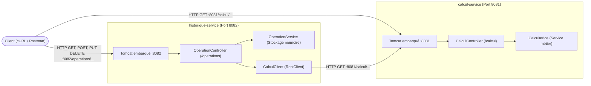

# TP3 REST : Architecture Microservices avec Spring Boot

**Faculté des Sciences de Sfax**  
**Département d'informatique et des Communications**  
*Année Universitaire : 2026-2027*  
*Matière :* Architecture MicroServices  
*Filière :* MPSRCC1  
*Enseignantes :* Corinne Amel ZAYANI, Amal ABID  

---

## 📋 Éléments à Rendre

Le présent document constitue le rapport technique complet du TP3, articulé autour des quatre livrables exigés :
1. [1. Les deux projets Maven complets (`calcul-service` et `historique-service`)](#1-les-deux-projets-maven-complets)
2. [2. Capture et traces montrant les deux consoles avec Tomcat 8081 et 8082](#2-démarrage-et-preuve-console-des-deux-microservices)
3. [3. Réponses exhaustives aux questions des parties A, C, D, E, F et Questions de Synthèse](#3-réponses-aux-questions-du-tp)
4. [4. Relevé exhaustif des tests F.6, F.7, F.8 et F.9 (Requêtes, Statuts, Corps et sorties `curl -i`)](#4-résultats-et-sorties-des-tests-f6-f7-f8-f9)

---

## 1. Les Deux Projets Maven Complets

L'application monolithique JAX-RS du TP2 est découpée en **deux microservices Spring Boot autonomes** communiquant via HTTP REST :



### 1.1 Microservice 1 : `calcul-service` (Port 8081)
- **Rôle :** Fournit les opérations arithmétiques pures (somme, soustraction, produit, division). Service totalement stateless sans dépendance vers d'autres services.
- **Port d'écoute :** `8081` (configuré dans [application.properties](file:///calcul-service/src/main/resources/application.properties)).
- **Classes principales :**
  - [`CalculServiceApplication.java`](file:///calcul-service/src/main/java/com/exemple/calcul/CalculServiceApplication.java) : Classe principale avec `@SpringBootApplication` et méthode `main`.
  - [`CalculController.java`](file:///calcul-service/src/main/java/com/exemple/calcul/controller/CalculController.java) : Contrôleur REST exposant les routes sous le préfixe `/calcul`.
  - [`Calculatrice.java`](file:///calcul-service/src/main/java/com/exemple/calcul/service/Calculatrice.java) : Composant Spring annoté `@Service` contenant la logique métier.
  - [`Resultat.java`](file:///calcul-service/src/main/java/com/exemple/calcul/model/Resultat.java) : DTO sérialisé en JSON pour les endpoints `/detail`.

### 1.2 Microservice 2 : `historique-service` (Port 8082)
- **Rôle :** Gère la persistance en mémoire de l'historique des opérations (`ConcurrentHashMap`). Pour calculer le résultat d'une nouvelle opération ou d'une modification, il appelle `calcul-service` via le client HTTP moderne Spring `RestClient`.
- **Port d'écoute :** `8082` (configuré dans [application.properties](file:///historique-service/src/main/resources/application.properties)).
- **Classes principales :**
  - [`HistoriqueServiceApplication.java`](file:///historique-service/src/main/java/com/exemple/historique/HistoriqueServiceApplication.java) : Classe principale avec `@SpringBootApplication` et méthode `main`.
  - [`CalculClient.java`](file:///historique-service/src/main/java/com/exemple/historique/client/CalculClient.java) : Client HTTP basé sur `RestClient` appelant l'URL configurable `calcul.service.url=http://localhost:8081`.
  - [`OperationController.java`](file:///historique-service/src/main/java/com/exemple/historique/controller/OperationController.java) : Contrôleur REST CRUD gérant les endpoints `/operations` et `/operations/{id}` (GET, POST, PUT, DELETE).
  - [`OperationService.java`](file:///historique-service/src/main/java/com/exemple/historique/service/OperationService.java) : Service Spring assurant le stockage thread-safe en mémoire vive.
  - [`Operation.java`](file:///historique-service/src/main/java/com/exemple/historique/model/Operation.java) : Modèle de données métier pour une opération arithmétique.

### 1.3 Arborescence Complète du Dépôt

```text
tp3-ms/
├── README.md                                 # Rapport complet du TP
├── .gitignore
├── operation.json                            # Exemple JSON pour POST
├── modification.json                         # Exemple JSON pour PUT
├── capture/                                  # Sorties d'exécution brutes et preuves console
│   ├── console_startup.txt                   # Traces de démarrage des deux microservices
│   ├── calcul_service_console.log
│   ├── historique_service_console.log
│   ├── C.2_post_somme.txt
│   ├── C.7_somme.txt
│   ├── D.1_soustraction.txt
│   ├── D.1_produit.txt
│   ├── D.2_division.txt
│   ├── D.2_division_zero.txt
│   ├── D.3_somme_invalid_a.txt
│   ├── D.3_somme_missing_b.txt
│   ├── D.4_produit_path.txt
│   ├── E.2_somme_detail.txt
│   ├── E.3_accept_json.txt
│   ├── E.3_accept_xml.txt
│   ├── E.4_division_detail.txt
│   ├── E.4_division_detail_zero.txt
│   ├── F.6_test1_post_somme.txt
│   ├── F.6_test2_post_division.txt
│   ├── F.6_test3_get_operations.txt
│   ├── F.6_test4_get_operation2.txt
│   ├── F.6_test5_get_operation99.txt
│   ├── F.6_test6_post_div_zero.txt
│   ├── F.6_test7_post_racine.txt
│   ├── F.7_test8_get_operations_stopped.txt
│   ├── F.7_test9_get_operation1_stopped.txt
│   ├── F.7_test10_post_produit_stopped.txt
│   ├── F.7_test10_post_produit_restarted.txt
│   ├── F.8_put_not_found.txt
│   ├── F.8_put_div_zero.txt
│   ├── F.8_put_success.txt
│   ├── F.8_get_after_put.txt
│   ├── F.9_delete_success.txt
│   ├── F.9_get_after_delete.txt
│   └── F.9_delete_again.txt
├── question/
│   └── reponse                               # Réponses textuelles aux questions
├── calcul-service/
│   ├── pom.xml                               # Configuration Maven Spring Boot 4.0.9
│   └── src/main/
│       ├── java/com/exemple/calcul/
│       │   ├── CalculServiceApplication.java
│       │   ├── controller/
│       │   │   └── CalculController.java
│       │   ├── service/
│       │   │   └── Calculatrice.java
│       │   └── model/
│       │       └── Resultat.java
│       └── resources/
│           └── application.properties        # server.port=8081
└── historique-service/
    ├── pom.xml                               # Configuration Maven Spring Boot 4.0.9
    └── src/main/
        ├── java/com/exemple/historique/
        │   ├── HistoriqueServiceApplication.java
        │   ├── client/
        │   │   └── CalculClient.java
        │   ├── controller/
        │   │   └── OperationController.java
        │   ├── service/
        │   │   └── OperationService.java
        │   └── model/
        │       └── Operation.java
        └── resources/
            └── application.properties        # server.port=8082 & calcul.service.url
```

---

## 2. Démarrage et Preuve Console des Deux Microservices

Les deux microservices sont démarrés simultanément dans deux consoles distinctes :

```bash
# Terminal 1 : Lancement de calcul-service (Port 8081)
cd calcul-service
mvn spring-boot:run

# Terminal 2 : Lancement de historique-service (Port 8082)
cd historique-service
mvn spring-boot:run
```

### Preuve Console (Extrait de [capture/console_startup.txt](file:///capture/console_startup.txt))

```text
================================================================================
CONSOLE 1 : calcul-service (Port 8081)
================================================================================
2026-11-02T21:48:33.250+01:00  INFO 21072 --- [calcul-service] [           main] c.e.calcul.CalculServiceApplication      : Starting CalculServiceApplication v0.0.1-SNAPSHOT using Java 25.0.4.1
2026-11-02T21:48:33.958+01:00  INFO 21072 --- [calcul-service] [           main] o.s.boot.tomcat.TomcatWebServer          : Tomcat initialized with port 8081 (http)
2026-11-02T21:48:34.888+01:00  INFO 21072 --- [calcul-service] [           main] o.s.boot.tomcat.TomcatWebServer          : Tomcat started on port 8081 (http) with context path '/'
2026-11-02T21:48:34.896+01:00  INFO 21072 --- [calcul-service] [           main] c.e.calcul.CalculServiceApplication      : Started CalculServiceApplication in 1.332 seconds (process running for 1.726)

================================================================================
CONSOLE 2 : historique-service (Port 8082)
================================================================================
2026-11-02T21:46:17.410+01:00  INFO 20468 --- [historique-service] [           main] c.e.h.HistoriqueServiceApplication       : Starting HistoriqueServiceApplication v0.0.1-SNAPSHOT using Java 25.0.4.1
2026-11-02T21:46:18.014+01:00  INFO 20468 --- [historique-service] [           main] o.s.boot.tomcat.TomcatWebServer          : Tomcat initialized with port 8082 (http)
2026-11-02T21:46:19.065+01:00  INFO 20468 --- [historique-service] [           main] o.s.boot.tomcat.TomcatWebServer          : Tomcat started on port 8082 (http) with context path '/'
2026-11-02T21:46:19.073+01:00  INFO 20468 --- [historique-service] [           main] c.e.h.HistoriqueServiceApplication       : Started HistoriqueServiceApplication in 1.487 seconds (process running for 1.874)
```

> [!NOTE]
> Les deux lignes exigées par le sujet apparaissent clairement :
> - **`Tomcat started on port 8081 (http) with context path '/'`**
> - **`Tomcat started on port 8082 (http) with context path '/'`**

---

## 3. Réponses aux Questions du TP

### Partie A : Questions de Conception (A.4)

#### Question A.4.1
**Dans le TP2, le résultat d'une opération était calculé par un simple appel de méthode. Dans ce TP, il est obtenu par une requête HTTP vers un autre microservice. Citez un avantage et un inconvénient de ce choix.**
> **Réponse :**  
> - **Avantage :** **Découplage architectural et scalabilité indépendante**. Chaque microservice possède son propre cycle de vie, ses propres ressources et peut être déployé ou mis à l'échelle (*scalé*) horizontalement indépendamment de l'autre (par exemple répliquer `calcul-service` si les calculs deviennent très intensifs en CPU sans gaspiller de mémoire pour l'historique).  
> - **Inconvénient :** **Latence et surcharge réseau** (overhead de connexion TCP/HTTP, sérialisation et désérialisation JSON), ainsi que l'obligation de gérer les **pannes partielles** du réseau ou l'indisponibilité du service distant.

#### Question A.4.2
**Si calcul-service est arrêté, quelles requêtes du tableau A.2 continuent de fonctionner ? Lesquelles échouent ?**
> **Réponse :**  
> - **Requêtes qui continuent de fonctionner :** Les requêtes de consultation et de suppression d'historique qui s'exécutent entièrement en local dans `historique-service` :  
>   - `GET /operations` (lecture de la liste)  
>   - `GET /operations/{id}` (lecture d'une opération par ID)  
>   - `DELETE /operations/{id}` (suppression d'une opération)  
> - **Requêtes qui échouent :**  
>   - Toutes les requêtes directes vers `calcul-service` : `GET /calcul/somme`, `/soustraction`, `/produit`, `/division`, `/detail` (le serveur 8081 est éteint).  
>   - `POST /operations` et `PUT /operations/{id}` sur `historique-service`, car ils doivent obligatoirement contacter `calcul-service` via HTTP pour calculer le résultat avant d'enregistrer l'opération.

#### Question A.4.3
**Pourquoi les deux microservices ne peuvent-ils pas écouter sur le même port ?**
> **Réponse :**  
> Au niveau du protocole TCP/IP géré par le système d'exploitation, un couple `(adresse IP, port)` ne peut être alloué qu'à un seul socket d'écoute à la fois. Si un second processus serveur tente d'écouter sur le même port de la même interface réseau, le système d'exploitation refuse la liaison et Spring Boot lève immédiatement une exception d'adresse déjà utilisée : `java.net.BindException: Address already in use`.

#### Question A.4.4
**Quel code de statut HTTP historique-service doit-il renvoyer quand il ne parvient pas à joindre calcul-service ?**
> **Réponse :**  
> Il doit renvoyer le code **`503 Service Unavailable`** (ou `502 Bad Gateway`). Ce code de la série 5xx informe explicitement le client que le serveur actuel agit en coordinateur et ne peut temporairement pas joindre le service amont indispensable au calcul, sans qu'il ne s'agisse d'une erreur de la requête cliente (4xx) ni d'un crash interne d'historique-service (500).

---

### Partie C : Premier Microservice (C.1, C.2)

#### Question C.1
**Comparez cette URL avec celle du TP2 (`http://localhost:8080/RestWebApp/api/calcul/somme?a=2&b=3`). Quelles parties ont disparu, et pourquoi ?**
> **Réponse :**  
> Le préfixe de contexte du fichier WAR (`/RestWebApp`) et le préfixe d'application JAX-RS (`/api`) ont disparu.  
> **Pourquoi :** Avec Spring Boot, chaque microservice dispose de son propre serveur web Tomcat embarqué dédié et écoute directement à la racine du serveur (`context path = '/'`) sur son propre port dédié (`8081`). Il n'est plus nécessaire de distinguer plusieurs applications partageant le même serveur Tomcat global.

#### Question C.2
**Remplacez GET par POST dans Postman et renvoyez la requête. Quel code de statut obtenez-vous ? Est-ce le même qu'au TP2 ?**
> **Réponse :**  
> On obtient le code HTTP **`405 Method Not Allowed`**.  
> **Oui, c'est exactement le même code de statut qu'au TP2**. Dans les deux frameworks, la ressource REST expose explicitement la méthode pour le verbe `GET` (`@GetMapping` en Spring, `@GET` en JAX-RS) et refuse toute méthode HTTP non déclarée avec le code standard 405.  
> *(Preuve enregistrée dans [capture/C.2_post_somme.txt](file:///capture/C.2_post_somme.txt))*.

---

### Partie D : Compléter la Calculatrice (D.1, D.2, D.3)

#### Question D.1
**Au TP2, JAX-RS donnait la valeur 0 à un paramètre entier absent et la méthode somme s'exécutait. Que fait Spring dans le même cas ? Laquelle des deux attitudes vous paraît la plus conforme à REST ?**
> **Réponse :**  
> Spring Boot rejette immédiatement la requête avec le code HTTP **`400 Bad Request`**, car par défaut, tout `@RequestParam` est obligatoire (`required = true`).  
> **Conformité REST :** L'attitude de **Spring est nettement plus conforme aux principes de REST** et de robustesse logicielle. Si une requête cliente est incomplète ou incorrecte, le serveur doit renvoyer une erreur 4xx explicite pour alerter le client, plutôt que d'injecter silencieusement une valeur par défaut arbitraire (`0`) qui fausse le calcul métier sans que le client ne s'en rende compte.

#### Question D.2
**Avec curl ou Postman, Spring renvoie ses messages d'erreur sous forme d'objet JSON. Quels champs contient-il ?**
> **Réponse :**  
> L'objet JSON d'erreur généré automatiquement par Spring Boot contient les 4 champs standards suivants :
> 1. `timestamp` : Date et heure de survenue de l'erreur au format ISO-8601 (ex : `2026-11-02T20:47:11.890+00:00`).
> 2. `status` : Code numérique du statut HTTP (ex : `400`).
> 3. `error` : Nom canonique de l'erreur HTTP (ex : `"Bad Request"`).
> 4. `path` : URI ciblée par la requête ayant causé l'erreur (ex : `"/calcul/somme"`).

#### Question D.3
**Complétez le tableau de correspondance : à quelles annotations JAX-RS correspondent `@RequestParam` et `@PathVariable` ? Laquelle utilisera-t-on pour lire l'identifiant dans `/operations/{id}` ?**
> **Réponse :**  
> - **`@RequestParam`** correspond à **`@QueryParam`** de JAX-RS (paramètres de chaîne de requête passés après le `?`).  
> - **`@PathVariable`** correspond à **`@PathParam`** de JAX-RS (variables intégrées dans le gabarit du chemin d'URI).  
> Pour lire l'identifiant dans l'URI `/operations/{id}`, on utilisera **`@PathVariable("id") int id`**.

---

### Partie E : Échanger des Données en JSON (E.1, E.2)

#### Question E.1
**Au TP2, JSON-B avait produit `{"a":2,"b":3,"operation":"somme","resultat":5.0}`. Les deux textes JSON sont-ils équivalents pour un client ? Qui a effectué la conversion cette fois-ci ?**
> **Réponse :**  
> - **Équivalence :** **Oui, les deux textes JSON sont strictement équivalents**. Selon la spécification officielle JSON (RFC 8259), un objet JSON est une collection non ordonnée de paires clé/valeur ; l'ordre d'apparition des champs dans la chaîne sérialisée n'a aucune valeur sémantique pour un parseur JSON client.  
> - **Convertisseur :** C'est la bibliothèque **Jackson** (`MappingJackson2HttpMessageConverter`), incluse de base dans la dépendance Spring Boot Starter Web (`spring-boot-starter-webmvc`), qui a effectué la sérialisation de l'objet Java `Resultat` en texte JSON.

#### Question E.2
**Pourquoi la seconde requête (`Accept: application/xml`) est-elle refusée, alors que le code de la méthode ne mentionne aucun format ?**
> **Réponse :**  
> Spring Boot met en œuvre le mécanisme standard de **négociation de contenu** (*Content Negotiation*). Lorsque le client envoie l'en-tête `Accept: application/xml`, il impose au serveur de lui fournir une réponse au format XML. Comme le projet ne contient que le convertisseur JSON (Jackson) et qu'aucune bibliothèque de sérialisation XML (telle que `jackson-dataformat-xml` ou JAXB) n'est présente dans le classpath, Spring est dans l'incapacité de satisfaire la demande du client et renvoie légitimement le code HTTP standard **`406 Not Acceptable`**.

---

### Partie F : Second Microservice & Résilience (F.1, F.2)

#### Question F.1
**Pourquoi les lectures continuent-elles de fonctionner alors que calcul-service est arrêté ? Une telle situation était-elle possible au TP2 ?**
> **Réponse :**  
> - **Fonctionnement des lectures :** Les requêtes de consultation (`GET /operations` et `GET /operations/{id}`) lisent directement et exclusivement la structure de données locale en mémoire vive (`OperationService` via `ConcurrentHashMap`) hébergée dans `historique-service`. Elles n'ont aucun besoin de contacter `calcul-service`.  
> - **Comparaison avec le TP2 :** **Une telle situation était strictement impossible au TP2**. Dans le TP2, l'application était un monolithe déployé au sein d'un seul fichier `.war` sur un serveur Tomcat unique. Si l'application ou le serveur s'arrêtait, l'intégralité des fonctionnalités (calcul et historique) tombait instantanément en panne en bloc.

#### Question F.2
**Pendant l'arrêt de calcul-service, le client a reçu une réponse 503 en moins d'une seconde. Que se serait-il passé sans le bloc catch (`ResourceAccessException e`) ?**
> **Réponse :**  
> Sans le bloc `catch (ResourceAccessException e)`, l'exception réseau levée par `RestClient` lors de l'échec de connexion TCP vers le port 8081 aurait traversé le contrôleur et aurait été interceptée par le gestionnaire d'erreurs par défaut de Spring. Celui-ci aurait renvoyé au client un code générique et inadapté **`500 Internal Server Error`** accompagné d'une stack trace technique. L'interception spécifique permet de convertir l'incident en un code propre, sémantique et conforme aux bonnes pratiques microservices : **`503 Service Unavailable`** avec le message JSON `{"erreur":"Service calcul-service indisponible"}`.

---

### Questions de Synthèse

#### Question Synthèse 1
**Reprenez le tableau A.3 et, pour chaque ligne, indiquez l'étape du TP où vous avez observé la différence.**

| Aspect | Différence observée | Étape du TP où la différence a été observée |
| :--- | :--- | :--- |
| **Technologie** | JAX-RS (Jersey) vs Spring Boot (Spring MVC) | **Partie B** (`pom.xml`) et **C.2** (annotations Spring) |
| **Découpage** | Monolithe unique (`.war`) vs 2 microservices autonomes | **Partie B** (création de `calcul-service`) et **F.1** (`historique-service`) |
| **Résultat de la construction** | Fichier `.war` vs Fichier `.jar` exécutable avec Tomcat embarqué | **Partie B.3** et **C.5** (construction Maven et packaging `fat-jar`) |
| **Serveur** | Tomcat externe standalone vs Tomcat embarqué démarré en Java | **Partie C.5** (`Tomcat started on port 8081`) |
| **Port** | Port unique `8080` vs Deux ports distincts `8081` et `8082` | **Partie C.4** (`application.properties` port 8081) et **F.1** (port 8082) |
| **Adresse** | URL avec `/RestWebApp/api/...` vs URL directe `/calcul/...` | **Partie C.6** et **C.7** (tests curl de l'URL racine) |
| **Activation** | Classe `@ApplicationPath` vs Classe `@SpringBootApplication` avec `main()` | **Partie B.4** (`CalculServiceApplication.java`) |
| **Ressource REST** | `@Path` sur classe vs `@RestController` + `@RequestMapping` | **Partie C.2** (`CalculController.java`) |
| **Verbes HTTP** | `@GET`, `@POST`, `@PUT`, `@DELETE` vs `@GetMapping`, `@PostMapping`, etc. | **Parties C.2, D.1, F.5, F.8, F.9** |
| **Paramètres** | `@QueryParam`, `@PathParam` vs `@RequestParam`, `@PathVariable`, `@RequestBody` | **Parties C.2, D.4, F.5** |
| **Réponse HTTP** | `Response.ok(...).build()` vs `ResponseEntity.ok(...)` | **Parties C.2, D.2, E.4, F.5** |
| **Conversion JSON** | JSON-B vs Jackson inclus par défaut | **Parties E.1 et E.2** (sérialisation de l'objet `Resultat`) |
| **Création des objets** | Instanciation manuelle `new` vs Injection de dépendances `@Service` | **Parties C.1, C.2, F.4, F.5** (injection Spring IoC par constructeur) |
| **Communication** | Appel direct en mémoire Java vs Requête réseau HTTP via `RestClient` | **Parties F.3 et F.5** (`CalculClient.java`) |

---

#### Question Synthèse 2
**Dressez le tableau de correspondance complet entre les annotations JAX-RS utilisées au TP2 et les annotations Spring utilisées dans ce TP.**

| Fonctionnalité / Rôle REST | Annotation JAX-RS (TP2) | Annotation Spring Boot (TP3) |
| :--- | :--- | :--- |
| Déclaration de contrôleur REST | *(aucune équivalente directe)* | `@RestController` |
| Préfixe d'URI commun sur la classe | `@Path("/calcul")` | `@RequestMapping("/calcul")` |
| Route HTTP GET | `@GET` + `@Path("/somme")` | `@GetMapping("/somme")` |
| Route HTTP POST | `@POST` + `@Path("/operations")` | `@PostMapping("/operations")` |
| Route HTTP PUT | `@PUT` + `@Path("/operations/{id}")` | `@PutMapping("/operations/{id}")` |
| Route HTTP DELETE | `@DELETE` + `@Path("/operations/{id}")` | `@DeleteMapping("/operations/{id}")` |
| Paramètre de requête (?a=2&b=3) | `@QueryParam("a")` | `@RequestParam("a")` |
| Paramètre de chemin ({id}) | `@PathParam("id")` | `@PathVariable("id")` |
| Corps de requête JSON | *(implicite)* + `@Consumes` | `@RequestBody` |
| Format de réponse produit | `@Produces(MediaType.APPLICATION_JSON)` | `produces = MediaType.APPLICATION_JSON_VALUE` *(ou implicite)* |
| Déclaration de composant métier | *(aucun / POJO instancié manuellement)* | `@Service` (ou `@Component`) |
| Injection de dépendance | `@Inject` | Injection par constructeur Spring (ou `@Autowired`) |

---

#### Question Synthèse 3
**Au TP2, une seule commande (`mvn clean package`) produisait un fichier `.war` qu'il fallait ensuite déployer dans Tomcat. Décrivez les commandes nécessaires pour construire et lancer les deux microservices de ce TP sans IntelliJ.**
> **Réponse :**  
> Les commandes à exécuter en ligne de commande depuis la racine `tp3-ms/` sont :
> ```bash
> # Étape 1 : Compilation et packaging des deux microservices en JARs exécutables
> cd calcul-service
> mvn clean package -DskipTests
> cd ../historique-service
> mvn clean package -DskipTests
> cd ..
> 
> # Étape 2 : Lancement des deux microservices dans deux terminaux indépendants
> # Console 1 :
> java -jar calcul-service/target/calcul-service-0.0.1-SNAPSHOT.jar
> 
> # Console 2 :
> java -jar historique-service/target/historique-service-0.0.1-SNAPSHOT.jar
> ```

---

#### Question Synthèse 4
**Un microservice est-il un service web ? Un service web est-il toujours un microservice ? Justifiez à l'aide de ce TP.**
> **Réponse :**  
> - **Un microservice est-il un service web ?** **Oui**, dès lors qu'il communique via les protocoles et standards du Web (HTTP, REST, JSON). Dans ce TP, `calcul-service` et `historique-service` sont des services web complets exposant des APIs REST.  
> - **Un service web est-il toujours un microservice ?** **Non**. L'application `RestWebApp` du TP2 était un service web RESTful complet, mais c'était un **monolithe** regroupant dans un unique livrable WAR toutes les fonctions de calcul et d'historique. Un service web n'est un microservice que s'il est découpé selon un domaine métier restreint et autonome, déployable et évolutif de façon totalement indépendante.

---

#### Question Synthèse 5
**Dans ce TP, l'adresse de calcul-service est écrite dans `application.properties` d'historique-service. Quel problème cela pose-t-il si l'on lance trois exemplaires de calcul-service pour répartir la charge ?**
> **Réponse :**  
> L'adresse étant statique et codée en dur (`http://localhost:8081`), `historique-service` continuera d'envoyer la totalité de ses requêtes à cette unique instance sur le port 8081.  
> **Problèmes générés :**  
> 1. `historique-service` ne peut pas découvrir dynamiquement les deux nouvelles instances (ex : lancées sur les ports 8083 et 8084).  
> 2. Il est incapable d'effectuer un équilibrage de charge (*Load Balancing*) entre les 3 instances.  
> 3. En cas de panne de l'instance 8081, il ne saura pas basculer (*failover*) sur l'une des autres instances saines.  
> **Solution requise :** L'introduction d'un annuaire d'enregistrement et de découverte de services (*Service Registry* type Netflix Eureka ou HashiCorp Consul) combiné à un équilibreur de charge côté client (*Spring Cloud LoadBalancer*), objet du TP4.

---

#### Question Synthèse 6
**Le principe stateless (sans état) interdit au serveur de mémoriser l'état du client entre deux requêtes. historique-service conserve pourtant la liste des opérations. Expliquez pourquoi cela ne contredit pas ce principe.**
> **Réponse :**  
> Le principe *stateless* interdit au serveur de stocker **l'état conversationnel d'une session client** (comme un panier d'achat temporaire ou une étape de dialogue propre à un client particulier).  
> En revanche, la liste des opérations conservée par `historique-service` constitue une **ressource du domaine métier partagée** (l'équivalent d'une table dans une base de données). Chaque requête HTTP reçue par `historique-service` est entièrement autonome et auto-suffisante : elle contient toutes les informations requises pour être exécutée sans dépendre d'un contexte de session préalable.

---

#### Question Synthèse 7
**Vous envoyez deux fois la même requête POST `/operations`, puis deux fois la même requête PUT `/operations/1`. Comparez l'effet de la répétition dans les deux cas. La réponse est-elle différente de celle du TP2 ?**
> **Réponse :**  
> - **Répétition de `POST /operations` :** La méthode `POST` n'est **pas idempotente**. Chaque envoi successif crée une nouvelle ressource distincte en mémoire avec un nouvel identifiant auto-incrémenté (`id=1` au premier appel, puis `id=2` au second appel). L'état du système est modifié à chaque appel supplémentaire.  
> - **Répétition de `PUT /operations/1` :** La méthode `PUT` est **idempotente**. Le premier appel remplace l'opération n°1 avec les données fournies. Le second appel réécrit exactement les mêmes valeurs sur la ressource n°1 : après le deuxième appel, l'état du système reste rigoureusement identique à celui obtenu après le premier.  
> - **Comparaison avec le TP2 :** **La réponse et les effets observés sont exactement identiques à ceux du TP2**, conformément aux spécifications sémantiques du protocole HTTP.

---

## 4. Résultats et Sorties des Tests (F.6, F.7, F.8, F.9)

Pour chaque test exécuté, nous présentons la **requête envoyée**, le **statut HTTP**, le **corps de la réponse** et la **sortie exacte `curl -i`** issue du dossier [`capture/`](file:///capture/).

---

### 4.1 Tests F.6 : Validation du Contrôleur `historique-service`

#### Test 1 : `POST /operations` (Somme 8 + 2)
- **Requête :** `curl -i -X POST http://localhost:8082/operations -H "Content-Type: application/json" -d "{\"operateur\":\"somme\",\"a\":8,\"b\":2}"`
- **Statut obtenu :** `201 Created`
- **En-tête `Location` :** `http://localhost:8082/operations/1` (ou `/operations/2` selon l'ordre)
- **Corps obtenu :** `{"id":1,"operateur":"somme","a":8,"b":2,"resultat":10.0}`
- **Sortie brute `curl -i` ([capture/F.6_test1_post_somme.txt](file:///capture/F.6_test1_post_somme.txt)) :**
```http
HTTP/1.1 201 
Location: http://localhost:8082/operations/2
Content-Type: application/json
Transfer-Encoding: chunked
Date: Mon, 02 Nov 2026 20:47:44 GMT

{"a":8,"b":2,"id":2,"operateur":"somme","resultat":10.0}
```

---

#### Test 2 : `POST /operations` (Division 7 / 2)
- **Requête :** `curl -i -X POST http://localhost:8082/operations -H "Content-Type: application/json" -d "{\"operateur\":\"division\",\"a\":7,\"b\":2}"`
- **Statut obtenu :** `201 Created`
- **Corps obtenu :** `{"id":1,"operateur":"division","a":7,"b":2,"resultat":3.5}`
- **Sortie brute `curl -i` ([capture/F.6_test2_post_division.txt](file:///capture/F.6_test2_post_division.txt)) :**
```http
HTTP/1.1 201 
Location: http://localhost:8082/operations/1
Content-Type: application/json
Transfer-Encoding: chunked
Date: Mon, 02 Nov 2026 20:47:44 GMT

{"a":7,"b":2,"id":1,"operateur":"division","resultat":3.5}
```

---

#### Test 3 : `GET /operations` (Liste de toutes les opérations)
- **Requête :** `curl -i http://localhost:8082/operations`
- **Statut obtenu :** `200 OK`
- **Corps obtenu :** Tableau JSON contenant les opérations enregistrées.
- **Sortie brute `curl -i` ([capture/F.6_test3_get_operations.txt](file:///capture/F.6_test3_get_operations.txt)) :**
```http
HTTP/1.1 200 
Content-Type: application/json
Transfer-Encoding: chunked
Date: Mon, 02 Nov 2026 20:47:44 GMT

[{"a":7,"b":2,"id":1,"operateur":"division","resultat":3.5},{"a":8,"b":2,"id":2,"operateur":"somme","resultat":10.0}]
```

---

#### Test 4 : `GET /operations/2` (Lecture par ID existant)
- **Requête :** `curl -i http://localhost:8082/operations/2`
- **Statut obtenu :** `200 OK`
- **Corps obtenu :** `{"id":2,"operateur":"somme","a":8,"b":2,"resultat":10.0}`
- **Sortie brute `curl -i` ([capture/F.6_test4_get_operation2.txt](file:///capture/F.6_test4_get_operation2.txt)) :**
```http
HTTP/1.1 200 
Content-Type: application/json
Transfer-Encoding: chunked
Date: Mon, 02 Nov 2026 20:47:44 GMT

{"a":8,"b":2,"id":2,"operateur":"somme","resultat":10.0}
```

---

#### Test 5 : `GET /operations/99` (Lecture par ID inexistant)
- **Requête :** `curl -i http://localhost:8082/operations/99`
- **Statut obtenu :** `404 Not Found`
- **Corps obtenu :** *(Corps vide)*
- **Sortie brute `curl -i` ([capture/F.6_test5_get_operation99.txt](file:///capture/F.6_test5_get_operation99.txt)) :**
```http
HTTP/1.1 404 
Content-Length: 0
Date: Mon, 02 Nov 2026 20:47:44 GMT
```

---

#### Test 6 : `POST /operations` (Division par 0 impossible)
- **Requête :** `curl -i -X POST http://localhost:8082/operations -H "Content-Type: application/json" -d "{\"operateur\":\"division\",\"a\":7,\"b\":0}"`
- **Statut obtenu :** `400 Bad Request`
- **Corps obtenu :** `{"erreur":"Erreur : division par 0 impossible"}`
- **Sortie brute `curl -i` ([capture/F.6_test6_post_div_zero.txt](file:///capture/F.6_test6_post_div_zero.txt)) :**
```http
HTTP/1.1 400 
Content-Type: application/json
Transfer-Encoding: chunked
Date: Mon, 02 Nov 2026 20:47:44 GMT

{"erreur":"Erreur : division par 0 impossible"}
```

---

#### Test 7 : `POST /operations` (Opérateur inconnu : racine)
- **Requête :** `curl -i -X POST http://localhost:8082/operations -H "Content-Type: application/json" -d "{\"operateur\":\"racine\",\"a\":9,\"b\":0}"`
- **Statut obtenu :** `400 Bad Request`
- **Corps obtenu :** `{"erreur":"Opérateur inconnu : racine"}`
- **Sortie brute `curl -i` ([capture/F.6_test7_post_racine.txt](file:///capture/F.6_test7_post_racine.txt)) :**
```http
HTTP/1.1 400 
Content-Type: application/json
Transfer-Encoding: chunked
Date: Mon, 02 Nov 2026 20:47:44 GMT

{"erreur":"Opérateur inconnu : racine"}
```

---

### 4.2 Tests F.7 : Expérience d'Arrêt d'un Microservice & Résilience

Dans cette expérience, le microservice `calcul-service` (Port 8081) est délibérément arrêté (`Ctrl+C`), tandis que `historique-service` (Port 8082) continue de s'exécuter.

#### Test 8 : `GET /operations` pendant l'arrêt de `calcul-service`
- **Requête :** `curl -i http://localhost:8082/operations`
- **Statut obtenu :** `200 OK`
- **Observation :** Les lectures continuent de fonctionner parfaitement.
- **Sortie brute `curl -i` ([capture/F.7_test8_get_operations_stopped.txt](file:///capture/F.7_test8_get_operations_stopped.txt)) :**
```http
HTTP/1.1 200 
Content-Type: application/json
Transfer-Encoding: chunked
Date: Mon, 02 Nov 2026 20:48:02 GMT

[{"a":7,"b":2,"id":1,"operateur":"division","resultat":3.5},{"a":8,"b":2,"id":2,"operateur":"somme","resultat":10.0}]
```

---

#### Test 9 : `GET /operations/1` pendant l'arrêt de `calcul-service`
- **Requête :** `curl -i http://localhost:8082/operations/1`
- **Statut obtenu :** `200 OK`
- **Corps obtenu :** `{"id":1,"operateur":"division","a":7,"b":2,"resultat":3.5}`
- **Sortie brute `curl -i` ([capture/F.7_test9_get_operation1_stopped.txt](file:///capture/F.7_test9_get_operation1_stopped.txt)) :**
```http
HTTP/1.1 200 
Content-Type: application/json
Transfer-Encoding: chunked
Date: Mon, 02 Nov 2026 20:48:02 GMT

{"a":7,"b":2,"id":1,"operateur":"division","resultat":3.5}
```

---

#### Test 10 : `POST /operations` pendant l'arrêt de `calcul-service`
- **Requête :** `curl -i -X POST http://localhost:8082/operations -H "Content-Type: application/json" -d "{\"operateur\":\"produit\",\"a\":3,\"b\":4}"`
- **Statut obtenu :** `503 Service Unavailable`
- **Corps obtenu :** `{"erreur":"Service calcul-service indisponible"}`
- **Observation :** L'exception `ResourceAccessException` a été interceptée avec succès en moins d'une seconde, sans plantage 500.
- **Sortie brute `curl -i` ([capture/F.7_test10_post_produit_stopped.txt](file:///capture/F.7_test10_post_produit_stopped.txt)) :**
```http
HTTP/1.1 503 
Content-Type: application/json
Transfer-Encoding: chunked
Date: Mon, 02 Nov 2026 20:48:03 GMT

{"erreur":"Service calcul-service indisponible"}
```

---

#### Test 10 bis : `POST /operations` après redémarrage de `calcul-service`
- **Action préalable :** `calcul-service` est relancé sur le port 8081.
- **Requête :** `curl -i -X POST http://localhost:8082/operations -H "Content-Type: application/json" -d "{\"operateur\":\"produit\",\"a\":3,\"b\":4}"`
- **Statut obtenu :** `201 Created`
- **Corps obtenu :** `{"id":3,"operateur":"produit","a":3,"b":4,"resultat":12.0}`
- **Sortie brute `curl -i` ([capture/F.7_test10_post_produit_restarted.txt](file:///capture/F.7_test10_post_produit_restarted.txt)) :**
```http
HTTP/1.1 201 
Location: http://localhost:8082/operations/3
Content-Type: application/json
Transfer-Encoding: chunked
Date: Mon, 02 Nov 2026 20:48:38 GMT

{"a":3,"b":4,"id":3,"operateur":"produit","resultat":12.0}
```

---

### 4.3 Tests F.8 : Modification d'une Opération (`PUT /operations/{id}`)

#### Test PUT 1 : `PUT /operations/99` (Opération inexistante)
- **Requête :** `curl -i -X PUT http://localhost:8082/operations/99 -H "Content-Type: application/json" -d "{\"operateur\":\"somme\",\"a\":1,\"b\":1}"`
- **Statut obtenu :** `404 Not Found`
- **Corps obtenu :** *(Corps vide)*
- **Sortie brute `curl -i` ([capture/F.8_put_not_found.txt](file:///capture/F.8_put_not_found.txt)) :**
```http
HTTP/1.1 404 
Content-Length: 0
Date: Mon, 02 Nov 2026 20:49:02 GMT
```

---

#### Test PUT 2 : `PUT /operations/1` (Calcul impossible : division par 0)
- **Requête :** `curl -i -X PUT http://localhost:8082/operations/1 -H "Content-Type: application/json" -d "{\"operateur\":\"division\",\"a\":10,\"b\":0}"`
- **Statut obtenu :** `400 Bad Request`
- **Corps obtenu :** `{"erreur":"Erreur : division par 0 impossible"}`
- **Sortie brute `curl -i` ([capture/F.8_put_div_zero.txt](file:///capture/F.8_put_div_zero.txt)) :**
```http
HTTP/1.1 400 
Content-Type: application/json
Transfer-Encoding: chunked
Date: Mon, 02 Nov 2026 20:49:02 GMT

{"erreur":"Erreur : division par 0 impossible"}
```

---

#### Test PUT 3 : `PUT /operations/1` (Modification réussie : produit 8 * 2)
- **Requête :** `curl -i -X PUT http://localhost:8082/operations/1 -H "Content-Type: application/json" -d "{\"operateur\":\"produit\",\"a\":8,\"b\":2}"`
- **Statut obtenu :** `200 OK`
- **Corps obtenu :** `{"id":1,"operateur":"produit","a":8,"b":2,"resultat":16.0}`
- **Sortie brute `curl -i` ([capture/F.8_put_success.txt](file:///capture/F.8_put_success.txt)) :**
```http
HTTP/1.1 200 
Content-Type: application/json
Transfer-Encoding: chunked
Date: Mon, 02 Nov 2026 20:49:02 GMT

{"a":8,"b":2,"id":1,"operateur":"produit","resultat":16.0}
```

---

#### Test PUT 4 : `GET /operations/1` (Vérification de la mise à jour)
- **Requête :** `curl -i http://localhost:8082/operations/1`
- **Statut obtenu :** `200 OK`
- **Corps obtenu :** `{"id":1,"operateur":"produit","a":8,"b":2,"resultat":16.0}`
- **Sortie brute `curl -i` ([capture/F.8_get_after_put.txt](file:///capture/F.8_get_after_put.txt)) :**
```http
HTTP/1.1 200 
Content-Type: application/json
Transfer-Encoding: chunked
Date: Mon, 02 Nov 2026 20:49:02 GMT

{"a":8,"b":2,"id":1,"operateur":"produit","resultat":16.0}
```

---

### 4.4 Tests F.9 : Suppression d'une Opération (`DELETE /operations/{id}`)

#### Test DELETE 1 : `DELETE /operations/1` (Suppression réussie)
- **Requête :** `curl -i -X DELETE http://localhost:8082/operations/1`
- **Statut obtenu :** `204 No Content`
- **Corps obtenu :** *(Sans corps)*
- **Sortie brute `curl -i` ([capture/F.9_delete_success.txt](file:///capture/F.9_delete_success.txt)) :**
```http
HTTP/1.1 204 
Date: Mon, 02 Nov 2026 20:49:20 GMT
```

---

#### Test DELETE 2 : `GET /operations/1` (Vérification de la disparition)
- **Requête :** `curl -i http://localhost:8082/operations/1`
- **Statut obtenu :** `404 Not Found`
- **Corps obtenu :** *(Corps vide)*
- **Sortie brute `curl -i` ([capture/F.9_get_after_delete.txt](file:///capture/F.9_get_after_delete.txt)) :**
```http
HTTP/1.1 404 
Content-Length: 0
Date: Mon, 02 Nov 2026 20:49:20 GMT
```

---

#### Test DELETE 3 : `DELETE /operations/1` (Seconde suppression / Idempotence de l'état absent)
- **Requête :** `curl -i -X DELETE http://localhost:8082/operations/1`
- **Statut obtenu :** `404 Not Found`
- **Corps obtenu :** *(Corps vide)*
- **Sortie brute `curl -i` ([capture/F.9_delete_again.txt](file:///capture/F.9_delete_again.txt)) :**
```http
HTTP/1.1 404 
Content-Length: 0
Date: Mon, 02 Nov 2026 20:49:20 GMT
```

---

## 5. Synthèse Récapitulative des Statuts HTTP

| Étape | Requête ciblée | Statut HTTP | Signification REST |
| :---: | :--- | :---: | :--- |
| **F.6** | `POST /operations` (données valides) | **201 Created** | Ressource créée, avec en-tête `Location: /operations/{id}` |
| **F.6** | `GET /operations` | **200 OK** | Collection complète retournée en JSON |
| **F.6** | `GET /operations/{id}` (existant) | **200 OK** | Ressource unique retournée en JSON |
| **F.6** | `GET /operations/99` (inconnu) | **404 Not Found** | Aucune ressource correspondante trouvée |
| **F.6** | `POST /operations` (division par 0 / op inconnu) | **400 Bad Request** | Erreur de validation de la requête du client |
| **F.7** | `GET /operations` (calcul-service arrêté) | **200 OK** | Haute disponibilité des données en mémoire locale |
| **F.7** | `POST /operations` (calcul-service arrêté) | **503 Service Unavailable** | Défaillance gérée du service amont |
| **F.8** | `PUT /operations/{id}` (modification valide) | **200 OK** | Ressource mise à jour avec succès |
| **F.8** | `PUT /operations/99` (ID inconnu) | **404 Not Found** | Impossible de modifier une ressource inexistante |
| **F.9** | `DELETE /operations/{id}` (première fois) | **204 No Content** | Ressource supprimée avec succès, aucun corps renvoyé |
| **F.9** | `DELETE /operations/{id}` (deuxième fois) | **404 Not Found** | La ressource a déjà été supprimée |
